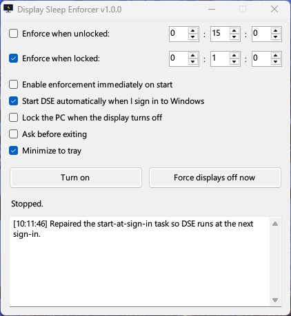
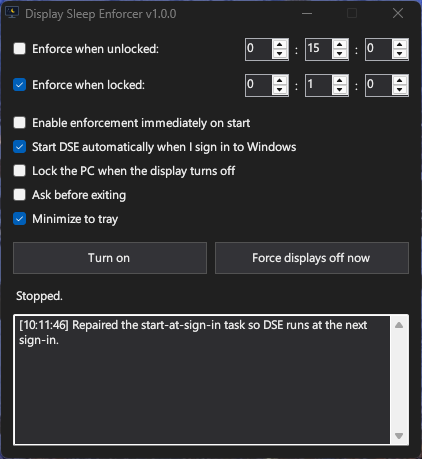

# Display Sleep Enforcer

**Status:** Stable (v1.0.4)

Display Sleep Enforcer (DSE) is a small Windows tray application that forces displays to turn off after an idle timeout. Two things set it apart: it enforces display sleep when applications (media players, browsers, etc.) are holding active display power requests, whether or not the PC is locked; and it can lock the PC the moment the display turns off — a feature that Windows obscures.

## Screenshots

| Light | Dark |
| :---: | :---: |
|  |  |

## Why this exists

Normally, when an app holds a "display required" power request (e.g. a video player or web video prevents the screen from dimming/off), Windows ignores its normal idle display timeout. When the PC is locked, this becomes problematic: even if the system's lock-screen timeout would normally turn the display off, an active request keeps it on. This is especially worrisome for OLED users.

DSE works around this by temporarily overriding the global Windows policy `"Allow display required policy"` (setting it to `No`), which makes Windows ignore display power requests. The override is held for as long as the active mode applies — the whole locked period with locked enforcement, or the entire run while unlocked enforcement is on — allowing the display to turn off even while media continues playing. DSE restores the original policy whenever it no longer applies (for example on unlock when only locked enforcement is selected), and on stop or exit.

## Features

- **Two independent timers** — one for **unlocked** (idle) enforcement and one for **locked** enforcement. Enable either or both; each has its own `hh:mm:ss` timeout.
  - **Locked** (enabled by default, `00:01:00`): turns displays off N seconds after the workstation is locked, overriding display power requests.
  - **Unlocked** (disabled by default, `00:15:00`): turns displays off when the system has been idle for N seconds while unlocked, overriding display power requests.
- **Displays power requests are overridden while enforcement is active** — handles media players, browsers, etc. during both locked and unlocked enforcement.
- **Re-asserts** the policy periodically while it is active to prevent other software from undoing it.
- **Force displays off now** — a button and a tray-menu item that turn the displays off immediately, whether or not enforcement is running.
- **Lock the PC when the display turns off** — a safeguard Windows does not provide conveniently. It works independently of Start/Stop for as long as DSE is running, and reacts to any cause of display-off (the power plan, unlocked enforcement, or a manual "Force displays off now").
- **Lock-screen slideshow guard** — the Windows lock-screen slideshow keeps requesting display-on and defeats enforcement. DSE checks at launch: if the slideshow is on, it warns you and offers to switch the background to Picture for you (Settings > Personalization > Lock screen). The installer offers the same switch as an install task, pre-checked when the slideshow is detected.
- **Crash recovery** — if DSE is killed before it can undo its power-plan edits, the original values are restored on the next launch, and a one-shot `RunOnce` entry restores them at the next sign-in even if DSE is never launched again.
- **Single instance** — launching a second copy tells you DSE is already running instead of disturbing the running one.
- **Tray minimization** (optional).
- **Confirm before exiting** (optional) — asks for confirmation before DSE closes, so the tray **Exit** item cannot shut it down by accident. The prompt is skipped during a Windows shutdown.
- **Remembers your settings** — timers, checkboxes, and appearance are saved and restored on the next launch.
- **Enforcement can start automatically** — tick **"Enable enforcement immediately on start"** and DSE begins enforcing the moment it launches, using whichever modes are selected. Otherwise it opens stopped and you press **Turn on** yourself. When you turn on start-at-sign-in (in the app) or leave the sign-in startup task selected (in the installer), DSE asks whether to enable this too.
- **Light/dark appearance** — follows the Windows theme by default; switch to Light or Dark any time from the tray menu's **Appearance** submenu. The installer also lets you pick the initial theme.
- **Per-user installer** or per-machine installer (choice on first wizard page).
- **Starts with Windows by default** — opt out in the installer or toggle "Start DSE automatically when I sign in to Windows" in the app. DSE registers a per-user Task Scheduler logon task with restart-on-failure, and verifies/repairs it on every launch (for example if the app has moved), warning you if it cannot. The task launches DSE minimized, so signing in does not pop a window up.

## Requirements

- Windows 10 or Windows 11 (x64; ARM64 via x64 emulation)
- .NET Framework 4.x (present on all supported Windows versions)

**Not supported:** Windows 8.1 and earlier, and Windows Server, are untested and not supported. The core mechanisms (the `VIDEOCONLOCK` power setting and `SystemEvents.SessionSwitch`) also exist on Windows 8/8.1, and the `powercfg` APIs predate that, so it *may* work there — but the "Allow display required policy" setting and modern lock-screen/power-request behavior are only documented for Windows 10/11, and DSE has only been tested on Windows 11. Treat 8.1 as untested, and 7/older as unsupported.

## Installation

1. Download the latest `DSE-Setup.exe` from [Releases](https://github.com/AlbaCorey/DisplaySleepEnforcer/releases).
2. Run it. The installer is **unsigned** — SmartScreen may show "unknown publisher." Select *More info → Run anyway* to continue.
3. Choose per-user or per-machine, pick the appearance (follow system, light, or dark), and finish the installation.

You can also run the portable `DisplaySleepEnforcer.exe` directly (it's included in the release assets as well as in `compiled/` when built from source).

## How to use

1. Launch "Display Sleep Enforcer" (from Start Menu/Desktop, or it starts automatically if sign-in startup is on).
   - Use the **"Start DSE automatically when I sign in to Windows"** checkbox to turn sign-in startup on/off at any time.
2. Choose the modes you want with the two checkboxes, each with its own **hh:mm:ss** timeout:
   - **"Enforce when locked"** (checked by default, `00:01:00`): turns the displays off this long after the PC is locked, overriding display power requests so the screen can go off even while media keeps playing.
   - **"Enforce when unlocked"** (unchecked by default, `00:15:00`): turns the displays off after the PC has been idle this long while it is unlocked, overriding display power requests so the screen can go off even while media keeps playing.
   - Either, both, or neither can be selected. The unlocked countdown pauses while the PC is locked.
3. Press **Turn on**.

To have DSE begin enforcing the moment it opens — for example when it starts with Windows — tick **"Enable enforcement immediately on start"**. It uses whichever modes you selected; otherwise DSE opens stopped and you press **Turn on** yourself.

To turn the displays off immediately at any time, use **"Force displays off now"** — the button in the window or the right-click item on the tray icon. This works whether or not enforcement is running.

To also have the PC lock whenever the display goes to sleep — for example when the normal power plan turns the display off — tick **"Lock the PC when the display turns off."** The toggle works independently of Start/Stop: it is active for as long as DSE is running.

The tray icon shows "Display Sleep Enforcer." Right-click to show the window, start/stop, force the displays off, choose the appearance (follow system, light, or dark), or exit.

To guard against closing DSE by accident, tick **"Ask before exiting"** — a confirmation prompt then appears whenever you exit the app (from the window or the tray), and is skipped when Windows itself is shutting down.

## Notes & caveats

- **Lock-screen slideshow conflicts with DSE**: Windows' lock-screen slideshow keeps requesting that the display stay on, so the display will not sleep under DSE's enforcement settings. This matters most for **"Enforce when locked"**, but it can also block unlocked enforcement while the lock screen is active. The conflict is specific to **Slideshow**, which rotates images while the lock screen is displayed; **Picture** and **Windows Spotlight** are both fine. Fix it by setting the lock screen background to **Picture** (Settings > Personalization > Lock screen) instead of **Slideshow** — DSE offers to do this for you at launch, and the installer has a task for it as well.
- **Testing**: v1.0.0 was validated by an automated robustness pass on Windows 11 — single-instance guard, crash recovery, settings persistence and malformed-settings fallback, start-at-sign-in task self-heal and legacy migration, exit paths, and headless `--restore-power`. The minimized sign-in startup added in v1.0.2 (`--minimized`) was verified the same way: tray-hidden and taskbar-minimized startup, auto-start enforcement while minimized, clean power restore on exit, and task self-heal when the path or the `--minimized` argument is stale. The sign-in-startup enforcement prompt added in v1.0.3 was verified in the app (Yes enables the setting, No leaves it off, already-on does not prompt) and in the installer (silent install writes the setting only when the startup task is selected). Two machines have been exercised so far, so sleep/hibernate and RDP-specific behavior are still not extensively verified — please file an issue if something misbehaves.
- **Global policy**: whenever an enforcement mode applies (the whole locked period with locked enforcement selected, or the entire run with unlocked enforcement selected), DSE writes `ALLOWDISPLAY=0` for the active power scheme (AC/DC). This is a system-wide setting change — it's necessary to ignore all display power requests. DSE captures and restores the original values whenever the override is no longer needed, and on stop/exit.
- **Crash recovery**: before editing the power plan, DSE saves the original values to `HKCU\Software\DisplaySleepEnforcer\Recovery` and registers a one-shot `RunOnce` cleanup (`DisplaySleepEnforcer.exe --restore-power`). If the process is hard-killed, the next launch restores the values and logs what it undid, then clears the record. A clean stop clears it immediately. The `RunOnce` entry restores the power plan at the next sign-in **independently of the start-at-sign-in setting**, so the system-wide change cannot outlive a crash even if DSE never runs again.
- **Damaged recovery record**: if `HKCU\Software\DisplaySleepEnforcer\Recovery` is ever edited or truncated by hand, DSE discards the stale record at startup, logs that it did so, and captures a fresh record the next time enforcement starts. A damaged record can never leave automatic recovery switched off.
- **Saved settings**: your timer values, checkboxes, and appearance are stored in `HKCU\Software\DisplaySleepEnforcer\Settings` and restored on the next launch. Enforcement starts stopped unless **"Enable enforcement immediately on start"** is ticked.
- **Unsigned binary**: no Authenticode signature; expect SmartScreen warnings.
- **Not admin required**: powercfg writes for the active scheme succeed for a standard user via the Power service, and the per-user logon task is created without elevation.
- **Sign-in task**: sign-in startup is a per-user Task Scheduler logon task named `DisplaySleepEnforcer`, not a `Run` key. The task launches DSE with `--minimized`, so it opens in the notification area instead of showing a window; the installer seeds the same `Run` value so startup works before the app first runs, and the app converts it to the task and removes the value. Uninstalling removes the task.

## How it works

- Detects lock/unlock via `SystemEvents.SessionSwitch` with a debounced desktop-name fallback.
- **Unlocked** and **locked** enforcement are independent, each with its own enable toggle and timeout.
- While locked: sets the "console lock display off timeout" (`VIDEOCONLOCK`) to the configured **locked** timeout plus a 5-second margin (so Windows schedules the display-off).
- Whenever an enforcement mode applies — the whole locked period with locked enforcement, or the entire run with unlocked enforcement — sets `ALLOWDISPLAY=0` ("Allow display required policy" = No) to override display power requests.
- Re-asserts `ALLOWDISPLAY=0` periodically while it is active in case another application resets it.
- Restores `ALLOWDISPLAY` as soon as no active mode needs it (for example on unlock when unlocked enforcement is off) and at stop; `VIDEOCONLOCK` is restored at stop.
- The same 5-second margin applies to **unlocked** enforcement, so the display turns off `N + 5` seconds after the last input — but only while unlocked (the unlocked countdown pauses once the PC is locked).
- **Lock on display off** subscribes the main window to `GUID_CONSOLE_DISPLAY_STATE` power notifications and calls `LockWorkStation()` whenever the console reports the display off — it does not depend on the Start/Stop state.
- **Start-at-sign-in uses Task Scheduler**: DSE creates a per-user logon task (`DisplaySleepEnforcer`) that ignores new instances, has no execution time limit, and restarts the app up to three times (one minute apart) if it exits with a failure. The task passes `--minimized`, so the app opens minimized (hidden to the tray when "Minimize to tray" is on) rather than popping a window up at sign-in. On each launch, when the option is on, DSE checks that the task exists, that its action points at the current executable, and that it still passes `--minimized`, re-registering it if not. If it still cannot confirm the task, it logs a warning and shows a message box. Upgrading from a version that used the `HKCU\...\Run` key migrates that entry to the task automatically.
- A named mutex enforces a single running instance, so a second copy cannot undo the power-plan changes out from under the live one.

## Building from source

Assumptions: .NET Framework 4.x (csc), PowerShell 5.1+, and [Inno Setup 6](https://jrsoftware.org/isinfo.php) installed at the default location (`%LOCALAPPDATA%\Programs\Inno Setup 6\ISCC.exe`).

From the project root:

```powershell
powershell -ExecutionPolicy Bypass -File source\build.ps1
```

This produces:
- `compiled\DisplaySleepEnforcer.exe` (application)
- `compiled\DSE-Setup.exe` (installer)
- `source\DSE.ico` (generated icon; committed)

To build without optional signing, add `-NoSign`. See `source\signing.example.ps1` for signing instructions.

The code lives in `source/` (`Program.cs` is the entry point, `MainForm.cs` and its
`MainForm.*.cs` partials are the UI, and the remaining files cover power settings, recovery,
theming and the enforcement loop); `compiled/` is build output and should never be edited by hand.

## Reporting bugs

Bug reports and feature requests are welcome on the [issue tracker](https://github.com/AlbaCorey/DisplaySleepEnforcer/issues). When reporting a display-sleep problem, please include:

- The DSE version (the release you installed, e.g. `1.0.4`).
- Your Windows version and build (`winver`).
- Which modes you enabled (locked, unlocked, or both) and the timeout(s) you set.
- Whether it happens with a specific app (media players, remote desktop, and so on).
- The relevant lines from the in-app log at the bottom of the window.

## License

Copyright (C) 2026 AlbaCorey

This program is free software: you can redistribute it and/or modify it under the terms of the **GNU General Public License** as published by the Free Software Foundation, either **version 3 of the License, or (at your option) any later version** (SPDX: `GPL-3.0-or-later`).

It is distributed in the hope that it will be useful, but **WITHOUT ANY WARRANTY**; without even the implied warranty of MERCHANTABILITY or FITNESS FOR A PARTICULAR PURPOSE. See the [full text](LICENSE) for details.
